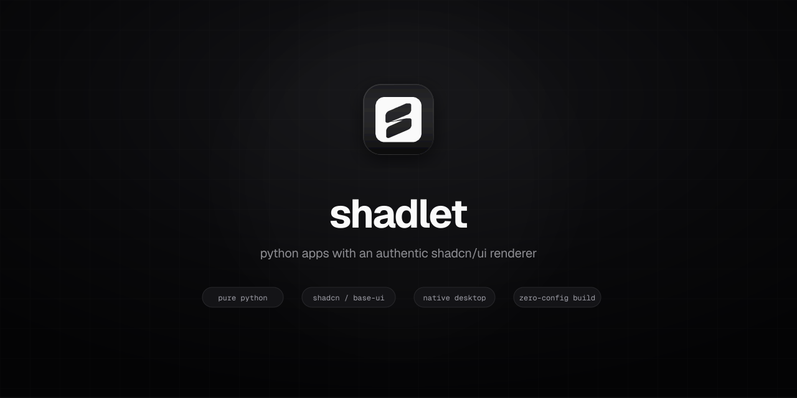
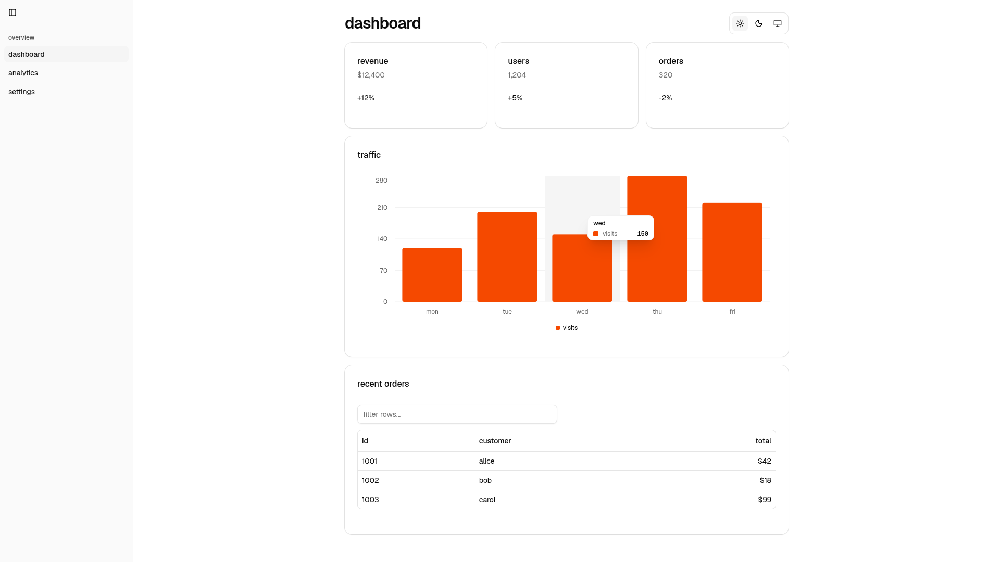
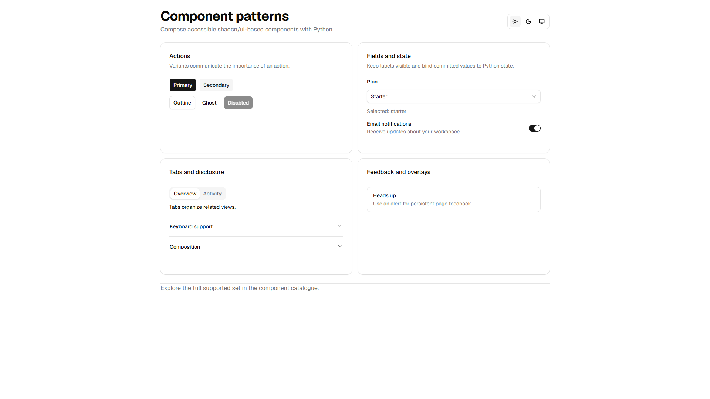
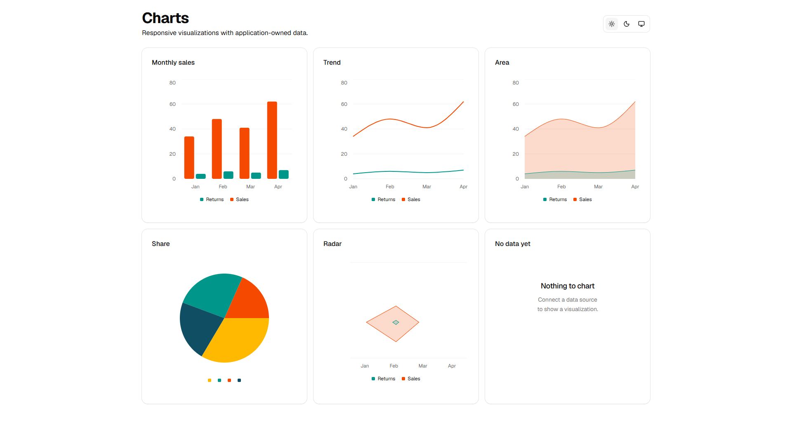
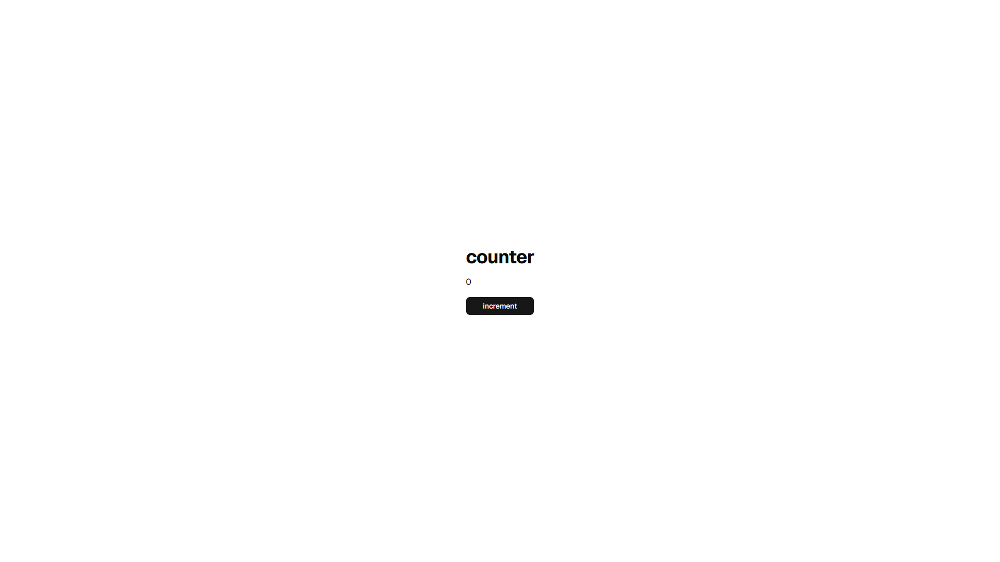
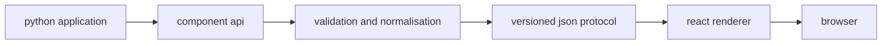

<div align="center">



[](https://github.com/programmersd21/shadlet/actions/workflows/ci.yml)
[](https://github.com/programmersd21/shadlet/actions/workflows/docs.yml)
[](https://www.python.org/)
[](https://github.com/programmersd21/shadlet/blob/main/LICENSE)
[](https://pypi.org/project/shadlet/)
[](https://programmersd21.github.io/shadlet/)

**python-first web applications with a shadcn/ui-based React renderer.**

</div>

shadlet is a framework that lets developers build modern web applications in python. React renders the interface with shadlet's shadcn/ui-based components and Base UI primitives. Python manages application state, events, routing and server-side logic. End users run applications with Python only; Node.js is needed only to build the renderer or an extension bundle.

shadlet 0.6.0 is a focused compatibility and developer-experience release. It
keeps protocol v2, fixes semantic HTML serialization and server-table bounds,
and includes runnable starter templates. See the [changelog](https://github.com/programmersd21/shadlet/blob/main/CHANGELOG.md) and
[verified limitations](https://github.com/programmersd21/shadlet/blob/main/docs/limitations.md) for the release scope and
documented runtime boundaries.

This release does not claim complete parity with the current shadcn/ui
catalogue; see the [component catalogue](docs/components/catalogue.md) for the
supported set.

## showcase

### dashboard



## components



## charts



## why shadlet

- python developers can build web applications using pure python.
- the renderer uses shadcn/ui design conventions, Tailwind CSS, and Base UI.
- components are strictly typed and validated across the protocol.
- reactive session state, async event handlers, and incremental patches.

## comparison

| feature | shadlet | typical python web ui |
|---|---|---|
| rendering | React + shadcn/ui-based components | server-rendered templates |
| state | reactive session state | request/response state |
| components | built-in shadcn/ui-based component library | custom widget sets |
| packaging | python wheel with bundled renderer | manual frontend build |

## features

- typed python component api with enums and validation
- built-in components based on shadcn/ui base-vega
- complete generated Lucide icon catalogue with a Python namespace
- official bundled geist variable & geist mono typography
- smooth animations, backdrop blur, and spring physics
- automatic port switching when default port is occupied
- hot reload with diff-based patches
- session-scoped reactive state
- async event handlers with cancellation
- pydantic v2 form submission validation with reactive field errors
- server-driven data table pagination, sorting, search, and validated queries
- reactive data table loading/error states, retry controls, per-column filters,
  and column visibility
- session-owned async background tasks with reactive progress and cancellation
- multipart http uploads with per-request size limits and app authentication
- typed query-parameter state synchronized with browser history
- separately packaged react extensions discovered from python entry points
- `shadlet extension create`, `build`, `check`, and `info` commands
- local upload storage with safe keys, atomic writes, and size limits
- versioned json protocol with incremental patches and shared pydantic/zod fixtures
- validated websocket handshake, token-based session restoration, and origin checks
- configurable connection authentication, event rate, payload, message, and render-tree limits
- typer and rich cli
- github project templates
- mkdocs documentation website

## installation

requirements:

- python 3.11 or newer

node.js is only required for maintainers building the renderer from source.
installed python extensions load their bundled browser assets without node or
npm.

```bash
pip install shadlet
```

for development from source:

```bash
uv pip install -e '.[dev]'
```

verify:

```bash
shadlet doctor
shadlet info
```

## quick start

create a project:

```bash
shadlet create my-app
cd my-app
shadlet dev
```

or write `main.py` directly:

```python
import shadlet as ui

app = ui.App("counter")


@app.page("/")
def home(ctx: ui.Context):
    count = ctx.state(0, key="count")

    def increment(event: ui.ClickEvent):
        count.value += 1

    return ui.Center(
        ui.Column(
            ui.Heading("counter"),
            ui.Text(count),
            ui.Button("increment", on_click=increment),
            gap=16,
        ),
        min_height="100vh",
    )


if __name__ == "__main__":
    app.run()
```

run:

```bash
python main.py
```

open `http://127.0.0.1:8000`.



## architecture



- python handles application logic.
- react handles rendering.
- communication uses a versioned json protocol over websocket.

## project structure

```text
shadlet/
  packages/python/shadlet   python runtime
  packages/renderer         react renderer
  templates                 project templates
  examples                  example applications
  tests                     python tests
  docs                      documentation
```

## examples

- [runnable examples and learning path](examples/README.md): state, forms,
  routing, components, responsive layouts, tables, charts, background tasks,
  storage, multipart uploads, icons, and deployment.

install shadlet from the repository root, then start an example:

```bash
python -m pip install -e .
cd examples/counter && python main.py
```

## agent skills

The repository includes ten task-specific [Agent Skills](.agents/skills/README.md)
for building apps, designing interfaces, authoring components and extensions,
debugging, contributing, review, testing, releases, and migrations. Canonical
skills are shared across Codex, Cursor, Gemini CLI, and GitHub Copilot; Claude
Code and Copilot code review receive validated mirrors.

## documentation

full documentation is in `docs/` and built with mkdocs. The [Agent Skills guide](docs/guides/agent-skills.md)
describes the included workflows and host discovery locations.

the python extension, upload, query-state, and browser testing APIs are
documented in their guides. see [limitations](https://github.com/programmersd21/shadlet/blob/main/docs/limitations.md) for the
verified scope and remaining boundaries.

```bash
python -m mkdocs serve
python -m mkdocs build --strict
```

## development

clone and set up:

```bash
git clone https://github.com/programmersd21/shadlet
cd shadlet
uv venv --python 3.11
uv pip install -e '.[dev]'
cd packages/renderer && npm ci
```

checks:

```bash
ruff check .
ruff format --check .
mypy .
pyright packages/python/shadlet
pytest
cd packages/renderer && npm run lint && npm run format:check && npm run typecheck && npm run test && npm run build
python -m mkdocs build --strict
```

## compatibility

- python 3.11 or newer
- browsers: current evergreen browsers

## community

- [contributing](https://github.com/programmersd21/shadlet/blob/main/CONTRIBUTING.md)
- [code of conduct](https://github.com/programmersd21/shadlet/blob/main/CODE_OF_CONDUCT.md)
- [security](https://github.com/programmersd21/shadlet/blob/main/SECURITY.md)
- [support](https://github.com/programmersd21/shadlet/blob/main/SUPPORT.md)
- [discussions](https://github.com/programmersd21/shadlet/discussions)
- [changelog](https://github.com/programmersd21/shadlet/blob/main/CHANGELOG.md)

## ai assistance and transparency

shadlet is developed by human maintainers with assistance from ai tooling.
ai assistance is used for drafting, refactoring, documentation, and review support.
all code is reviewed by maintainers and must pass the project's lint, type, test,
and build checks before release. see [contributing](https://github.com/programmersd21/shadlet/blob/main/CONTRIBUTING.md) for the
ai code policy.

## license

mit licensed. see [LICENSE](https://github.com/programmersd21/shadlet/blob/main/LICENSE) for full details.

## status

see [limitations](https://github.com/programmersd21/shadlet/blob/main/docs/limitations.md) for the verified support matrix and
capabilities.
