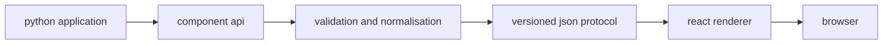

<div align="center">


[](https://github.com/programmersd21/shadlet/actions/workflows/ci.yml)
[](https://github.com/programmersd21/shadlet/actions/workflows/docs.yml)
[](https://www.python.org/)
[](https://github.com/programmersd21/shadlet/blob/main/LICENSE)
[](https://pypi.org/project/shadlet/)
[](https://programmersd21.github.io/shadlet/)

**python-first web applications with a genuine shadcn/ui renderer.**

</div>

shadlet is a framework that lets developers build modern web applications in python. react renders the interface with authentic shadcn/ui components. python manages application state, events, routing and server-side logic. end users run applications with python only; node.js is only needed to build the renderer.

## showcase


## why shadlet

- python developers can build web applications using pure python.
- the frontend is genuine shadcn/ui (tailwind + base-ui), not an imitation.
- components are strictly typed and validated across the protocol.
- reactive session state, async event handlers, and incremental patches.

## comparison

| feature | shadlet | typical python web ui |
|---|---|---|
| rendering | react + authentic shadcn/ui | server-rendered templates |
| state | reactive session state | request/response state |
| components | 56 built-in shadcn/ui components | custom widget sets |
| packaging | python wheel with bundled renderer | manual frontend build |

## features

- typed python component api with enums and validation
- 56 built-in components from shadcn/ui base-vega
- official bundled geist variable & geist mono typography
- smooth animations, backdrop blur, and spring physics
- automatic port switching when default port is occupied
- hot reload with diff-based patches
- session-scoped reactive state
- async event handlers with cancellation
- versioned json protocol with incremental patches
- typer and rich cli
- github project templates
- mkdocs documentation website

## installation

requirements:

- python 3.11 or newer

node.js is only required for maintainers building the renderer from source.

```bash
uv pip install -e '.[dev]'
```

verify:

```bash
shadlet doctor
shadlet info
```

## quick start

create a project:

```bash
shadlet create my-app
cd my-app
shadlet dev
```

or write `main.py` directly:

```python
import shadlet as ui

app = ui.App("counter")


@app.page("/")
def home(ctx: ui.Context):
    count = ctx.state(0, key="count")

    def increment(event: ui.ClickEvent):
        count.value += 1

    return ui.Center(
        ui.Column(
            ui.Heading("counter"),
            ui.Text(count),
            ui.Button("increment", on_click=increment),
            gap=16,
        ),
        min_height="100vh",
    )


if __name__ == "__main__":
    app.run()
```

run:

```bash
python main.py
```

open `http://127.0.0.1:8000`.


## architecture



- python handles application logic.
- react handles rendering.
- communication uses a versioned json protocol over websocket.

## project structure

```text
shadlet/
  packages/python/shadlet   python runtime
  packages/renderer         react renderer
  templates                 project templates
  examples                  example applications
  tests                     python tests
  docs                      documentation
```

## examples

- `examples/counter` minimal counter
- `examples/todo` todo list with forms
- `examples/dashboard` dashboard with charts and tables

run any example:

```bash
cd examples/counter
PYTHONPATH=../../packages/python python main.py
```

## documentation

full documentation is in `docs/` and built with mkdocs.

```bash
python -m mkdocs serve
python -m mkdocs build --strict
```

## development

clone and set up:

```bash
git clone https://github.com/programmersd21/shadlet
cd shadlet
uv venv --python 3.11
uv pip install -e '.[dev]'
cd packages/renderer && npm ci
```

checks:

```bash
ruff check .
ruff format --check .
mypy .
pyright packages/python/shadlet
pytest
cd packages/renderer && npm run lint && npm run format:check && npm run typecheck && npm run test && npm run build
python -m mkdocs build --strict
```

## compatibility

- python 3.11 or newer
- browsers: modern desktop browsers

## community

- [contributing](CONTRIBUTING.md)
- [code of conduct](CODE_OF_CONDUCT.md)
- [security](SECURITY.md)
- [support](SUPPORT.md)
- [discussions](https://github.com/programmersd21/shadlet/discussions)
- [changelog](CHANGELOG.md)

## ai assistance and transparency

shadlet is developed by human maintainers with assistance from ai tooling.
ai assistance is used for drafting, refactoring, documentation, and review support.
all code is reviewed by maintainers and must pass the project's lint, type, test,
and build checks before release. see [contributing](CONTRIBUTING.md) for the
ai code policy.

## license

mit licensed. see [LICENSE](LICENSE) for full details.

## status

release ready (v0.1.0). see `docs/limitations.md` for the verified support matrix and capabilities.
